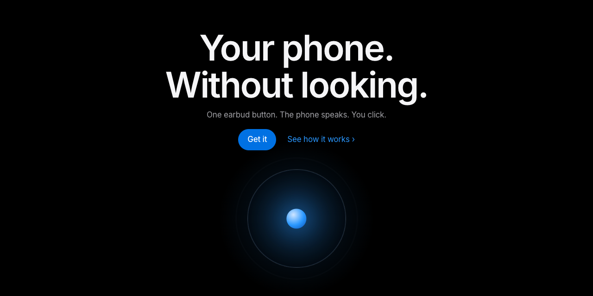

<div align="center">



# Invisible OS

**Your phone. Without looking.**<br>
One earbud button. The phone speaks. You click.

[**Website**](https://invisible-os.vercel.app) &nbsp;·&nbsp; [**Get it**](#install) &nbsp;·&nbsp; [**How it works**](#how-it-works) &nbsp;·&nbsp; [**Laptop**](#laptop-your-agents-in-your-ear)

</div>

<br>

Invisible OS is an open-source Android app: a small operating system for your ears. A menu, apps, games and a keyboard, all with the screen off and the phone in your pocket. It turns the one button on any wired or Bluetooth earbud into the whole interface.

## How it works

1. **Turn the screen off.** The phone keeps working. It just stops asking for your eyes.
2. **Your ears become the screen.** The phone speaks its menu, one item at a time.
3. **Your button becomes the mouse.** Click when you hear the one you want.

This is *auto-scan* (single-switch scanning, the method used in assistive technology). One button is enough.

**No microphone. No cloud. No account.** The app never listens. Everything stays on the phone.

> Keywords: Android accessibility app, headset button controller, earbud button actions, screen-off phone control, eyes-free phone, hands-free WhatsApp reply, single-switch scanning, auto-scan menu, blind and low-vision friendly, text-to-speech, Kotlin.

## The button

| Gesture | Phone idle or music playing | Inside the menu |
|---|---|---|
| 1 click | Play / pause | Pick the option you just heard |
| 2 clicks | Next track | Previous item in a list |
| 3 clicks | Previous track | Go back one level |
| Hold | Wake the menu (works on the lock screen) | Leave / exit |

Menu items: **Messages** (read, reply, or turn a message into a task; Spanish or English), **Tasks** (a to-do list you add to and finish by ear), **Timer**, **Volume**, **Status** (time, battery, unread, next alarm, weather, next event, navigation step), **Games** (Duel, Echo, Guard), **Laptop** (see below), **More** (torch, do not disturb, find my phone, exit). Apps are also in a tree by what you want to do (Talk, Plan, Pay, Work, Watch and listen, Play, Go, Tools); a hold on the home list opens Find by first letters.

## Highlights

- **Reply to WhatsApp, Teams and WeChat** notifications by earbud. Reply candidates are built from the message, and the language is detected on the device.
- **Undo window.** After a send you have a few seconds to cancel with any click.
- **Tasks by ear.** "Add task" is always the first option. It offers your past tasks, then starters. Click a task right after you hear it to finish it (3 s to cancel). Share text from Keep or any app to add tasks too.
- **One way to pick a text.** Tasks and replies use the same step: your own past texts first, then new ones.
- **Local AI (optional).** Turn on "AI on the phone" in the app. It downloads Gemma 4 E2B (2.6 GB, Wi-Fi only, resumes) and runs it on the phone. It writes reply sentences and clean to-do items from a message. Needs about 6 GB RAM and 3.3 GB free. Off by default; the APK has no model inside.
- **Learns what you use.** Options you pick often move to the front. Optional sped-up "spearcons" are off by default (switch in the app). Everything stays on the phone.
- **Sound design for no-screen use.** Each screen has its own short tone, so words are optional. See [SOUND-DESIGN.md](SOUND-DESIGN.md).
- **Settings screen.** Check setup in one place, then choose which menu items you hear, their order, timer lengths, pause, voice speed, cancel time and more.
- **Battery friendly.** Nothing polls. It reacts to button presses.
- **Private.** No account, no analytics, no microphone. The internet is used only to download the AI model, when you ask.

## Laptop: your agents in your ear

If you work in tmux with several Claude Code agents, the **Laptop** tool turns each tmux window into a *room*. It needs the small bridge server on your laptop ([`bridge/`](bridge/), over Tailscale, with a token).

- Rooms are named by what they work on. The one that needs you is read first, with Claude's "What needs me" line.
- One click sends an answer: go, yes, commit, push, explain, stop, or an option the agent quoted. Order adapts to what you pick in each project.
- Projects: continue one, or start a new one (area, name and first ask with the Write keyboard).
- Shell rooms: run again, make targets from the project's Makefile, stop.
- With the phone unlocked: see a room's screen in the app, or jump to Termux.
- Still no microphone. Every send is logged in `~/.config/invisible-bridge/sends.log`.

Design and evidence: [bridge/DESIGN-ROOMS.md](bridge/DESIGN-ROOMS.md). API: [bridge/ROOMS-API.md](bridge/ROOMS-API.md).

## Install

Invisible OS never listens. It has no microphone permission. It has no account and no ads. It works offline.


1. Scan with your phone camera and install.
2. Open Invisible OS, allow Button access.
3. Hold your earbud button.

No QR? Open this link on your phone: <https://github.com/IFAKA/invisible-os/releases/latest/download/invisible-os.apk>

Android will warn about installing from outside the Play Store: that is normal for open-source apps. Needs Android 10 or newer.

On some phones (Xiaomi / HyperOS and others) also allow the app to run in the background and turn off battery optimization for it, or the system may stop it when the screen is off. At first the app asks only for Button access. Other permissions are asked when a feature first needs them. The Assistant (hold on the lock screen) is offered on the app screen after the first practice.

### Build from source

You need the Android SDK and a phone with USB debugging.

```sh
cd app && ./gradlew assembleDebug
adb install -r app/build/outputs/apk/debug/app-debug.apk
```

or run `app/run.sh` (build, install, start). Maintainers: `tools/release.sh VERSION` builds the signed release APK (it does not publish).

## Share the APK

`share/invisible.apk` is a debug-signed build with setup steps in `share/SETUP.txt` (the APK is git-ignored; build it yourself). Build it from a clean commit. The new phone needs "install unknown apps", Button access and Notification access turned on by hand.

## Docs

- [UX-DESIGN.md](UX-DESIGN.md): goals, research on single-switch scanning, gesture cost model, design decisions.
- [SOUND-DESIGN.md](SOUND-DESIGN.md): earcon rules and the full sound set (listen in `sound/wav/`).
- [sdk/GUIDE.md](sdk/GUIDE.md): make your own program for the OS (starter project, tests, kit check, how to hand it in).
- [GAME-TELL.md](GAME-TELL.md): the Duel audio game.
- [NEW-MESSAGE-IDEA.md](NEW-MESSAGE-IDEA.md): researched idea for starting a new chat with the screen off (not built).

## Tests

```sh
cd app && ./gradlew testDebugUnitTest
```

The menu is a pure state machine ([`ControllerMode.kt`](app/os/src/main/java/com/faka/invisible/ControllerMode.kt)) with injected time and output, so gestures, scanning, undo and replies are unit tested.

## Who it is for

People who cannot or do not want to look at the phone: blind and low-vision users, people with motor limits, runners, cyclists, cooks, drivers (where legal), or anyone who wants to answer a message without taking the phone out.

## Status

Early, personal project, used daily. Issues and ideas are welcome.

## License

MIT, see [LICENSE](LICENSE).
